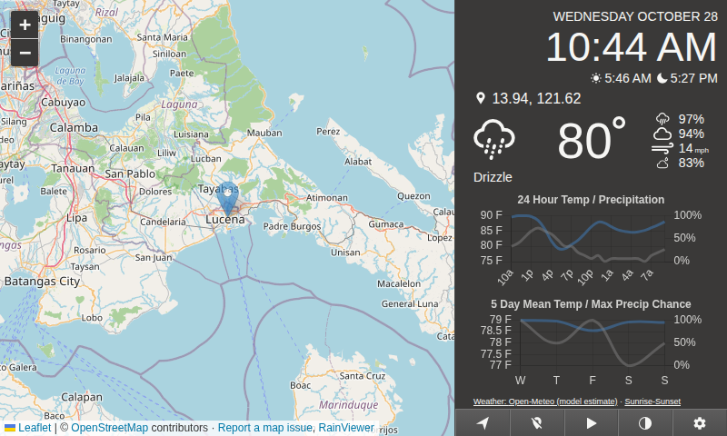
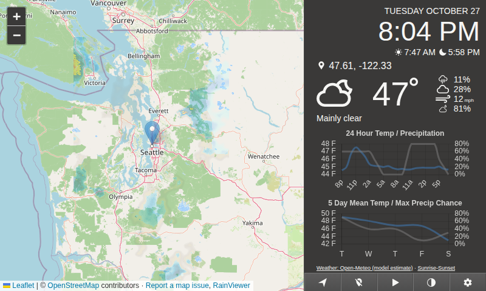

# Pi Weather Station

Turn a Raspberry Pi touchscreen, spare monitor, or desktop browser into a weather dashboard: current conditions, hourly and five-day charts, a map with past radar, a clock, and sunrise/sunset times.

**Start with your location—no provider accounts or API keys required for a new personal, noncommercial setup.** Version 3.1 defaults to Open-Meteo weather and OpenStreetMap. Internet access is required; provider terms and coverage apply.

[](https://github.com/SeanRiggs/pi-weather-station/actions/workflows/test.yml)

[Quick start](#quick-start) · [Screenshots](#see-it-in-action) · [Upgrading](UPGRADING.md) · [Troubleshooting](docs/OPERATIONS.md#troubleshooting) · [Contributing](CONTRIBUTING.md)

## Quick start

**Already running an older version?** Start with the [upgrade guide](UPGRADING.md) to preserve your settings, especially if your Docker installation mounts a volume over `/app`.

### Portainer

**No terminal or source build needed:** open **Stacks → Add stack → Web editor**, paste [compose.portainer.yml](compose.portainer.yml), and set your server address and dashboard password under Environment variables. The [Portainer guide](docs/PORTAINER.md) walks through each step. The public image automatically supports AMD64, ARM64, and ARMv7.

### Docker Compose

For a fresh installation, install Git and Docker with Compose v2, then run:

```sh
git clone https://github.com/SeanRiggs/pi-weather-station.git
cd pi-weather-station
docker compose up -d --build
```

Open **http://127.0.0.1:8080 on the machine running Docker**. The image builds locally and settings persist in a named volume. The default port is available only on that host; see [access configuration](docs/OPERATIONS.md#configuration) for another device.

This builds the image on your own machine; Portainer users can use the prebuilt GHCR image above. **Existing Docker Hub tags have not been republished with this refresh.** See the [Docker guide](Docker%20Image/Docker-ReadMe.md) for details. On ARMv7 / 32-bit Raspberry Pi OS, use `NODE_VERSION=22 docker compose up -d --build`; AMD64 and ARM64 use Node 24 by default. ARMv6 is not supported by these builds.

### Run directly with Node.js

Install Git and Node.js 24, then run:

```sh
git clone https://github.com/SeanRiggs/pi-weather-station.git
cd pi-weather-station
npm ci
npm --prefix client ci
npm run build
npm start
```

Open **http://127.0.0.1:8080** on that machine in a current Chromium-based browser. The server stays running in your terminal; it does not launch a browser automatically. Node 22 is also covered by server tests.

### Set up your display

1. Open **Settings** using the gear icon.
2. Enter your starting latitude and longitude in decimal degrees; use negative values for south/west. Browser location permission is an alternative.
3. Keep **Open-Meteo** and **OpenStreetMap** selected, then save.
4. Confirm the conditions and forecast charts load. Set the display device's timezone to match your location, then use browser full-screen/kiosk mode if desired.

Coordinates are shown instead of a city name unless you configure optional LocationIQ. Existing Tomorrow.io and Mapbox users can retain those providers or switch in Settings without losing saved keys.

Use the play control for **past radar** animation, the theme control for light/dark mode, and the location control to return to your starting location. The dashboard fits the original 800 × 480 display and stacks vertically on smaller screens.

## See it in action

Two views of version 3.1 running with live provider data and no provider accounts or API keys. These are captured examples, not a live weather feed.

### Lucena City, Philippines

Current conditions and forecast charts beside a local map and past-radar overlay.



### Seattle, Washington

A wider regional view makes the radar precipitation east of Seattle visible while keeping the selected location's conditions and forecasts alongside it.



Captured October 28, 2026 (UTC), at 800 × 480. The capture browsers were set to each location's timezone, so the Seattle view shows the previous evening. Click either image to view it at full size.

Maps © [OpenStreetMap contributors](https://www.openstreetmap.org/copyright); weather by [Open-Meteo](https://open-meteo.com/), radar by [RainViewer](https://www.rainviewer.com/), and sunrise/sunset by [Sunrise-Sunset](https://sunrise-sunset.org/).

## What has been verified?

The October 28, 2026 verification passed **36 server tests**, accelerated outage/recovery checks, and a **five-hour browser stability run**. Regular CI also checks browser behavior and Docker startup/settings persistence on AMD64, ARM64, and emulated ARMv7.

The five-hour run used simulated providers and tiles, plus four successful live Open-Meteo/RainViewer probes. Physical Raspberry Pi touchscreen use and continuous live-service operation still need testing on your installation. Read the [results and limitations](docs/TESTING.md).

## Guides

| I want to… | Start here |
| --- | --- |
| Deploy through Portainer's Web editor | [Portainer guide](docs/PORTAINER.md) |
| Upgrade an existing installation safely | [Upgrade guide](UPGRADING.md) |
| Choose a Docker architecture or understand image tags | [Docker guide](Docker%20Image/Docker-ReadMe.md) |
| Choose providers or understand free-service limits | [Provider guide](docs/PROVIDERS.md) |
| Configure settings, private access, or fix a problem | [Operations and troubleshooting](docs/OPERATIONS.md) |
| See what changed | [Changelog](CHANGELOG.md) |
| Improve the project or report a bug | [Contributing](CONTRIBUTING.md) |

Open-Meteo conditions are model estimates; radar animation shows the past. Coverage and service availability vary. This dashboard does not provide severe-weather alerts or safety-critical forecasts.

## Credits and license

Built on [Eric Lewin's Pi Weather Station](https://github.com/elewin/pi-weather-station), retaining the original layout and MIT attribution. This fork adds maintained provider integrations, Docker source builds, safer settings handling, and automated verification.

MIT licensed. Original copyright © 2020 Eric Lewin; see [LICENSE](LICENSE).
